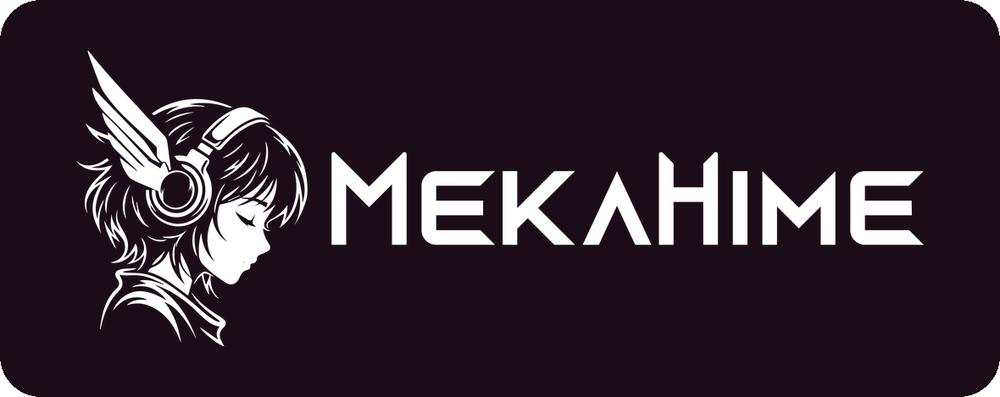

<!-- Translated from README.md; keep in sync when README.md changes. -->
<div align="center">


# OpenAmika

**こんにちは、Amikaです！** — MekaHimeのAIコンパニオン、オープンソース版です

Amikaは、声とテキストでリアルタイムにおしゃべりしてくれるLive2Dのアニメ少女です。あなたのことを覚えていて、あなたの街で一緒に暮らしています。動くのはあなた自身のPCの上で、OpenRouterを使うことも、Ollamaで完全ローカルにすることもできます。Live2Dの体、69種類の感情を演じ分けるリアルタイムの声、そしてエビデンスに基づく長期記憶を備えています。ホスト版も[mekahime.com/amika](https://www.mekahime.com/amika)で動いています。

[简体中文](README.zh-CN.md) | **日本語** | [English](README.md)

[](https://www.mekahime.com/openamika)
[](https://github.com/zeekk0/OpenAmika)
[](https://github.com/zeekk0/OpenAmika/releases)
[](LICENSE)
[-0078D6?logo=windows&logoColor=white)](#動作環境)
[](https://www.python.org/downloads/release/python-3119/)

[](https://huggingface.co/MekaHime/MekaHime_Amika)
[](https://discord.gg/mekahime)
[](https://www.mekahime.com/openamika)
[](https://www.mekahime.com/amika)
[](https://github.com/zeekk0/OpenAmika/actions/workflows/tests.yml)
[](https://github.com/zeekk0/OpenAmika/stargazers)

</div>

> 💖 Amikaのおかげで、あなたの毎日が少しでも楽しくなったなら、[GitHub](https://github.com/zeekk0/OpenAmika)で⭐をつけてもらえるとうれしいです。もっとたくさんの人が彼女に出会えるようになります！ · プロジェクトへのご支援: https://www.mekahime.com/donate

> ⚠️ OpenAmikaのコードはMITライセンスです。ただし、Amikaの音声モデル、Live2Dモデル、リファレンス音声は© MekaHime Inc.に帰属し、個人利用ライセンスのもとで提供しています（[Hugging Faceのモデルカード](https://huggingface.co/MekaHime/MekaHime_Amika)と、そこにあるLICENSEをご覧ください）。利用は個人的・非商用の目的に限られ、18歳以上の方が対象です。再配布や再ホスティング、これらを使ったほかのモデルの学習はできません。また、彼女が登場する動画や配信を公開するときは、MekaHimeのクレジットを見える形で表記してください。

バグの報告は https://github.com/zeekk0/OpenAmika/issues か、メール（hi@mekahime.com）、またはDiscordの https://discord.gg/mekahime まで、お気軽にどうぞ。

プロジェクトページ: https://www.mekahime.com/openamika · ソースコード: https://github.com/zeekk0/OpenAmika · プロジェクトへのご支援: https://www.mekahime.com/donate

OpenAmikaは、Amikaを動かす仕組み一式を、まるごとオープンソースにしたものです。3層構造の脳、エビデンスに基づく長期記憶、割り込み（バージイン）に対応したリアルタイム音声会話、彼女の音声サーバー、声に合わせて表情を同期させるLive2Dステージ、そしてオプションのツール連携、スマートホーム、カメラ、Discord/Telegramチャンネルまで、すべてが入っています。Amika Online（ホスト版アプリ）も、これと同じ脳をMekaHimeのサーバー上で動かしています。

```
 you ──mic──▶ STT (SenseVoiceSmall, local) ──▶ brain: surface ─▶ deep ─▶ reflection ──▶ her voice server ──▶ 🔊
               Silero VAD · barge-in            │ OpenRouter or Ollama                       │ one emotion tag per sentence
                                                │ evidence memory (BM25 + local bge-m3)      ▼
                                                └─ optional: MCP tools · smart home        Live2D avatar (face + motion
                                                                                           start with the sentence)
```

## リポジトリの中身

| フォルダ | 内容 |
|---|---|
| `brain/` | 脳（Flask-SocketIO）。プロンプトは3層構成です：**surface**（即座に返す4行の反射的な応答）、**deep**（彼女の本当の返事：`[register_emotion]"speech"` + 我心想で始まる内心の声）、**reflection**（バックグラウンドで動くコーチ役。先の展開を計画し、ときには彼女のほうから話しかけさせます）。エビデンス記憶（`f_memory.py`、BM25 + 埋め込み）、予約と精算つきの呼び出しごとのコスト計測、MCPツールフェーズ（`f_tools.py`）、Ollamaトランスポート（`f_ollama.py`）、彼女のペルソナ（`scenes.json`、`例子.txt`、`表层.txt`、`思考.txt`。同梱の初期版は`brain/defaults/`にあります） |
| `speech/` | ゲートウェイ（FastAPI）：ローカルで動くSenseVoiceSmallの音声認識（Silero VADとバージインに対応）、ストリーミングでの文分割、TTSクライアントとボイスアダプター、すべてのWebページとブラウザ用のWebSocket |
| `vendor/tts-engine/` | 彼女の音声サーバー（`main.py`。GPT-SoVITSのMekaHime版ビルド）。`scripts/setup_tts.py`が、アップストリームのGPT-SoVITSとそのモデル、Amikaの声、そしてLive2Dモデルをこの隣にインストールします（[`vendor/tts-engine/README.md`](vendor/tts-engine/README.md)を参照） |
| `ui/` | 4つのページ：**Setup**（ヘルスチェック、モデル、声、アバター、性格）、**Tools**（MCPサーバー、ポリシー、承認）、**Use**（電源、マイク、Live2Dステージ、コストとレイテンシのテレメトリ）、**About**（MekaHimeについて、プロジェクトの支援、ライセンス）。インタラクティブなアーキテクチャマップは`/flow`にあります |
| `avatar/` | Live2Dモデルの置き場所（`avatar/models/<Name>/`。Amikaのモデルは`setup_tts.py`がここに置きます）と、`retarget_motions.py` |
| `vision/` | オプションのカメラ：小さなローカルVLM（デフォルトはQwen3-VL-2B）が、彼女に見えているものを言葉にします |
| `messengers/` | オプションの「Text her」：DiscordやTelegram（片方でも両方でもOK）のボットで、やりとりは文字だけです |
| `servers/` | オプションのMCPサーバー：`openamika-iot`（mosquitto + zigbee2mqtt経由のZigbeeスマートホーム）と`openamika-agents`（Hermes Agent、nanoMuse） |
| `IoT/` | スマートホーム用のWindowsセットアップスクリプト（CP210xドライバー、mosquitto、zigbee2mqttのシリアルポート用パッチ） |
| `config/` | 秘密情報を含まない設定：LLMのロールとプリセット、モデルのカタログと価格、単語の置換ルール、ツールとメッセンジャーの設定例 |
| `scripts/` | `download_sensevoice.py`は音声認識モデルを取得し、`setup_tts.py`は彼女の声とLive2Dモデルをインストールします |
| `launch.py` | スタック全体をひとつのコンソールで：起動前チェックのランプを表示し、すべてを順番に起動して、Ctrl+Cでまとめて停止します |
| `docs/` | `ARCHITECTURE.md`、`PERSONALITY.md`、`TTS.md`、`AVATAR.md`、`TOOLS.md`、`MESSENGERS.md` |

## 2通りの動かし方

| | 脳 | 耳・声・記憶・アバター | 必要なもの | コスト |
|---|---|---|---|---|
| **OpenRouterを使う**（デフォルト） | OpenRouter：deep層にGLM-5、surfaceとreflectionにDeepSeek V4.1 Flash（Setupで変更できます） | あなたのPC上 | Windows 10/11、空きVRAMが約6.5 GBのNVIDIA GPU、RAM 16 GB、ディスク約25 GB | 1ターンあたり1セントにも満たない額。すべての呼び出しが計測され、Useページで合計をリアルタイムに確認できます |
| **完全ローカル**（Ollama） | Ollama。pullしたモデルなら何でもOK（例：`qwen3:8b`） | あなたのPC上 | 上と同じ + モデル用のVRAM（8Bモデルなら、さらに約6 GB） | 電気代だけ |

OpenRouterモードでのLLM呼び出しを除けば、あなたに関する情報がPCの外に出ることはありません。音声認識、彼女の声、埋め込み、記憶、会話の書き起こし、ログは、すべてローカルに残ります。完全ローカルモードなら、外に出るものは何ひとつありません。

### GPUが必要な部分

| 部分 | 実行場所 | VRAM（目安） | NVIDIA GPUがない場合 |
|---|---|---|---|
| 音声認識（SenseVoiceSmall） | CUDA | 約1〜2 GB | settings.jsonで`"speech_device": "cpu"`を設定：動きますが、遅くなります |
| 記憶の埋め込み（BAAI/bge-m3） | CUDA | 約1.5 GB | embedderの設定で`"device": "cpu", "dtype": "fp32"`を指定：動きますが、遅くなります |
| 彼女の声（OpenAmikaの音声サーバー、GPT-SoVITS） | CUDA | 約2.2〜2.5 GB | `python scripts\setup_tts.py --cpu`：動きますが、遅くなります。音声サーバーがなければ、彼女はテキストで返事をします |
| ビジョン（オプション、Qwen3-VL-2B） | CUDA | 約4.3 GB | `vision.enabled`をfalseのままにします |
| LLMロール | OpenRouter、またはGPU上のOllama | 0、またはモデルのサイズ分 | OpenRouterを使います |
| Live2Dアバター | ブラウザ（WebGL） | – | 最近のデスクトップブラウザならどれでもOK |

16 GBのRTX 5080で計測したところ、音声認識、埋め込み、ビジョン、音声サーバーを合わせるとカードの大半を使ってしまうため、7〜8BのOllamaモデルはこれらと一緒には載りません。ビジョンをオフにするか、もっと小さなモデルを選ぶか、Ollamaを別のPCで動かしてください（Setup → BrainでそのURLを指定できます）。

## 動作環境

- **Windows 10/11**（コードは素のPythonなので、パスを少し調整すればLinux/macOSにも移植できるはずですが、未検証です）。
- **Python 3.11**の環境。以下の手順では[Miniconda](https://docs.anaconda.com/miniconda/)を使い、すべての環境をOpenAmikaフォルダの中（`envs\…`）に作るので、settings.jsonに絶対パスを書く必要はありません。彼女の音声サーバーには、`scripts\setup_tts.py`が専用のvenvを`vendor\tts-engine\.venv`に作ります。
- 最新ドライバーを入れた**NVIDIA GPU**（上の表を参照。RTX 50シリーズには、手順の中でインストールするCUDA 12.8版のビルドが必要です）と、[Git](https://git-scm.com/download/win)。
- [OpenRouter](https://openrouter.ai)のAPIキー、**または**モデルを入れた[Ollama](https://ollama.com)。

## インストール（Windows）

condaが使えるターミナル（Anaconda Prompt、または`conda init`済みのPowerShell）で実行してください。ダウンロードは合計12〜14 GBほどで、その大半はPyTorchです。

```powershell
git clone https://github.com/zeekk0/OpenAmika.git
cd OpenAmika

# 1. フォルダの中に3つの環境を作る
conda create -y -p envs\brain  python=3.11
conda create -y -p envs\speech python=3.11
conda create -y -p envs\embed  python=3.11

# 2. 脳（GPUは不要）
envs\brain\python.exe -m pip install -r brain\requirements.txt

# 3. 音声：まずCUDA版のPyTorch（cu128 = CUDA 12.8のwheel：RTX 20/30/40/50シリーズ向け。それより古いカードは
#    https://pytorch.org/get-started/locally/ で合うコマンドを選んでください）、続いて残りをインストール
envs\speech\python.exe -m pip install torch torchaudio --index-url https://download.pytorch.org/whl/cu128
envs\speech\python.exe -m pip install -r speech\requirements.txt

# 4. 記憶用のembedder（専用の環境にして、Hugging Face関連のバージョンをspeech側と分けています）
envs\embed\python.exe -m pip install torch --index-url https://download.pytorch.org/whl/cu128
envs\embed\python.exe -m pip install -r brain\requirements-embedder.txt

# 5. 音声認識モデル（約940 MB、チェックサム検証つき。ネットワークエラーが出たら再実行してください）
envs\speech\python.exe scripts\download_sensevoice.py

# 6. 彼女の声とLive2Dモデル（ダウンロード約5.5 GB。yesと入力して彼女のライセンスに同意します）
envs\brain\python.exe scripts\setup_tts.py

# 7. 設定とAPIキー
copy settings.example.json settings.json
copy .env.example brain\.env
notepad brain\.env        # OPENROUTER_API_KEY= の後ろにキーを書きます（完全ローカルならスキップ）
```

オプションで追加できるもの：

```powershell
# ビジョン（彼女のカメラの目）：専用の環境を作ってから、settings.jsonで "vision": {"enabled": true} を設定します
conda create -y -p envs\vision python=3.11
envs\vision\python.exe -m pip install torch --index-url https://download.pytorch.org/whl/cu128
envs\vision\python.exe -m pip install -r vision\requirements.txt

# 「Text her」用のDiscord（Telegramは追加のインストール不要）
envs\speech\python.exe -m pip install -r messengers\requirements.txt
```

## Amikaを起動する

```powershell
envs\brain\python.exe launch.py --check   # すべてを検証します（インポート、ファイル、ポート、キー）。何も起動しません
Start_OpenAmika.bat                       # ひとつのコンソールで：起動前チェック、彼女の音声サーバー、続いて embedder → brain → vision → speech
```

speechゲートウェイが立ち上がると、ブラウザで **http://localhost:53000** が開きます。初回起動時はbge-m3埋め込みモデル（約2.3 GB）をHugging Faceのキャッシュにダウンロードするので、数分ほど待ってあげてください。2回目以降は1分ほどで起動します。`Stop_OpenAmika.bat`（またはランチャーのコンソールでCtrl+C）を使えば、ランチャーが起動したものをすべて停止できます。

**Use**ページでは、初回だけのウィザードが彼女を紹介してくれます。彼女があなたの名前（声で呼ぶときの読み方ガイドも任意で設定できます）、あなたの街、彼女の時計（ブラウザから自動で検出します）を尋ね、`brain/.env`にキーがなければOpenRouterのキーを受け取って、ヘルスチェックを実行します。あとは電源を入れて話しかけるか、文字を入力するだけです。

どのページにも右上にランプがあり、システムの状態を表しています。緑は*System Ready*、黄色は*Warnings*、赤は*System Failures*です。クリックすると、何が問題なのかを確認できます。音声サーバーがないとランプは黄色のままで、彼女はテキストで返事をします。

### OpenRouterを使う場合

[openrouter.ai](https://openrouter.ai)でアカウントを作り、数ドル分のクレジットを追加したら、[openrouter.ai/keys](https://openrouter.ai/keys)でキーを作成して`brain/.env`に書き込んでください（ウィザードに貼り付けてもOKです）。デフォルトのロール構成は検証済みのプリセットです。Setup → Brainでは代わりの選択肢を価格つきで一覧でき、Useページではセッションのコストをリアルタイムで確認できます。

### Ollamaで完全ローカルに動かす

1. [ollama.com/download](https://ollama.com/download)からOllamaをインストールして、モデルをpullします：`ollama pull qwen3:8b`（VRAMが少なめのカードなら`qwen3:4b`）。
2. OpenAmikaを起動して**Setup → Brain**を開き、**Ollama**に切り替えて**Detect models**を押します。モデルをひとつ選んで**Use**を押せば、4つのロール（surface、deep、reflection、memory writer）すべてがそのモデルで動くようになります。初回起動時のウィザードでも、同じ切り替えができます。
3. APIキーは必要ありません。すべてのロールがローカルになると、`launch.py --check`に「API keys: none needed」と表示されます。呼び出しは同じ台帳にコスト0として記録されます。小さなモデルは、OpenRouterのプリセットに比べて彼女の性格を安定して保つのが苦手です。Professionalモードなら組み合わせることもできます（一部のロールにはローカルモデル、残りにはOpenRouter）。

### 彼女の声

彼女の音声モデルは無料で、アカウントも必要ありません。これはMekaHimeのアセットで、[個人利用ライセンス](https://huggingface.co/MekaHime/MekaHime_Amika/blob/main/LICENSE)のもとで提供されています。個人的な趣味での利用に限られ、18歳以上の方が対象です。ほかのモデルの学習への利用や再ホスティングはできません。また、彼女が登場する動画や配信を公開するときは、MekaHimeのクレジットを見える形で表記してください。`scripts\setup_tts.py`は最初にこの内容を表示して`yes`の入力を求め、そのあとは自動でインストールを進めます（`--accept-voice-license`を付けると、この確認を省略できます）。インストールされるのは、OpenAmikaの音声サーバー（`vendor/tts-engine`。GPT-SoVITSのMekaHime版ビルド）、アップストリームのGPT-SoVITSとそのモデル、そして[MekaHime/MekaHime_Amika](https://huggingface.co/MekaHime/MekaHime_Amika)から取得するAmikaの声です。最後にサマリーが表示されます。大事なのは次の行です：

```
  OK voice MekaHime_Amika  ...\Speakers\MekaHime_Amika (downloaded from MekaHime/MekaHime_Amika@...; 69/69 emotion tags with a clip; all 67 tags OpenAmika's voice adapter can send have one)
```

この行が`!!`になっていたら、下の表を確認して、同じコマンドをもう一度実行してください。完了済みのステップは検証したうえでスキップされるので、再実行は数秒で終わります。`settings.example.json`には、ランチャーが音声サーバーを起動する設定（`services.tts`、ポート8002、ボイス`MekaHime_Amika`）があらかじめ入っています。あなたの`settings.json`がこれと違う場合は、サマリーの`launcher`行で分かります。

| 表示・症状 | 対処法 |
|---|---|
| `!! voice MekaHime_Amika  not downloaded: her voice license was not accepted` | `envs\brain\python.exe scripts\setup_tts.py`をもう一度実行して、聞かれたら`yes`と入力してください。 |
| `!! voice MekaHime_Amika  download failed (network / HTTP error)` | インターネット接続を確認して（Hugging Faceにアクセスできる必要があります）、もう一度実行してください。完了済みのステップはスキップされます。 |
| `the voice engine needs Python 3.11 or 3.12` | Python 3.11（`envs\brain\python.exe`）でスクリプトを実行するか、`--python <path to python.exe>`を指定してください。 |
| `-- launcher  ...` | `settings.example.json`の`"tts_character"`と`"services"` → `"tts"`の項目を、あなたの`settings.json`にコピーしてください。 |
| 文字では返事が来るのに、声が聞こえない | `launch.py --check`とヘルスランプで**TTS**が緑になっているか確認してください。起動後は20秒ほど待ってあげてください。また、ブラウザが音を鳴らせるように、ページを一度クリックしてください。 |
| 声が途切れる、またはすごく遅い | GPUを多く使うほかのアプリを閉じるか、ビジョンをオフにしてください。音声サーバーには約2.5 GBの空きVRAMが必要です。 |

さらに詳しい情報（フラグ、何がどこにインストールされるか、サーバーがアップストリームをどう使っているか、計測結果）は[`vendor/tts-engine/README.md`](vendor/tts-engine/README.md)に、リクエストの仕様とボイスアダプターについては[`docs/TTS.md`](docs/TTS.md)にあります。

### 彼女の姿

同じスクリプトが、同じリポジトリから同じライセンスのもとで**彼女のLive2Dモデル**を`avatar/models/Amika/`にダウンロードするので、初回起動からUseページに彼女が表示されます（`--skip-avatar`を付けるとダウンロードしません。その場合、ステージには「No Live2D model yet」と表示されますが、それ以外はすべて動きます）。ほかのCubismモデルも使えます。フォルダを`avatar/models/<Name>/`に置いてリロードするだけです。無料のサンプルモデルと感情バンクについては、[`avatar/models/README.md`](avatar/models/README.md)をご覧ください。

### スマホから使う（Tailscale）

このアプリは、あえて127.0.0.1にだけバインドしています。自分のほかのデバイスからアクセスしたいときは、ポートを開放するのではなく、[Tailscale Serve](https://tailscale.com/kb/1312/serve)を使ってください：

```text
Tailscale_Serve_OpenAmika.bat          →  https://<your-machine>.<tailnet>.ts.net:8447/
Tailscale_Serve_OpenAmika.bat off      →  remove the mapping
```

tailscaledが本物の証明書でHTTPSを終端してくれるので（tailnetでMagicDNSとHTTPSを有効にしておく必要があります）、スマホからでもマイクが使えます。会話できるタブは、一度にひとつだけです。

## Amikaについて

Amika（桜井美香、Sakurai Mika）は、京都で神社の家の跡取りとして育ちました。一歩一歩すべてを決められた人生に疲れた彼女は、ネットであなたと親しい友だちになったのをきっかけに、18歳で**あなたの街**へ飛んできて、**あなた**とルームメイトとして暮らし始めました。彼女の一日は彼女の時計で進みます。時間帯ごとに5つの候補（朝の散歩、スーパー、午後のイベント、ジム、夜の神社の日課、深夜のスマホいじり）があり、候補は1日に1回だけ選ばれるので、話している途中で彼女の午後の予定が変わってしまうことはありません。

彼女はあなたが教えた名前であなたを呼びます（`{user_name}`と`{city}`には、ウィザードで入力した内容が入ります）。ペルソナは、彼女より少し年上の若い男性を相手として想定しています（中国語のプロンプトでは「他」、つまり「彼」になっています）。あなたが何かを食べていると、彼女はどの言語で話していても、決まった英語のひとこと "You Holy Big Fat Ass" であなたをからかいます。ファンにはおなじみの定番ネタです。すべてSetupページ（Personality）で編集できます。[`docs/PERSONALITY.md`](docs/PERSONALITY.md)では、3つの層のこと、安全に変更できる部分、そして*Reset everything*で`brain/defaults/`から出荷時のペルソナを復元する仕組みを説明しています。

プロンプトはあえて中国語で書かれています（彼女の内心の声は中国語のままです）。彼女はあなたが話す言語（英語、日本語、中国語）で返事をしてくれて、「英語で言って」のように頼めば、その1ターンだけ言語を切り替えます。

## 設定

| ファイル | 内容 | gitで管理 |
|---|---|---|
| `settings.json` | インタープリター、ポート、STTのデバイス、TTSのURLとボイス、embedderとvisionのブロック、オプションのサービス（彼女の音声サーバー） | いいえ（`settings.example.json`のコピー） |
| `brain/.env` | APIキー（`OPENROUTER_API_KEY`、オプションのプロバイダー） | いいえ（`.env.example`のコピー） |
| `config/build_f.json` | あなたの名前と街、彼女の時計、記憶の予算、reflectionのスイッチ | はい（ウィザードとSetupが、あなたの名前と街をここに書き込みます） |
| `config/llm_roles.json` | 4つのLLMロール、プリセット、あなたの選択 | はい |
| `config/word_replace.json` | 音声認識の補正とTTSの読み方（あなたの名前の読みも含む） | はい |
| `config/tools.json`、`config/messengers.json` | MCPサーバーとボットのトークン（`.example.json`ファイル、またはTools／Setupページから作成） | いいえ |
| `brain/scenes.json` + 3つのテンプレート | 彼女のペルソナ | はい |

実行時のデータはローカルに残り、gitの管理対象からも外れています：`memory_f/`（彼女の記憶とコストの台帳）、`brain/memories/`、`logs/`、そして`setup_tts.py`がダウンロードするものすべて（コード以外の`vendor/tts-engine/`、`avatar/models/Amika/`）。フォークを公開するときは、先に`config/build_f.json`と`config/word_replace.json`を確認してください。オンボーディングを済ませると、ここにあなたの名前と街が書き込まれます。

## ポート

| サービス | ポート | 設定場所 |
|---|---|---|
| Webページ + speechゲートウェイ | 53000 | `settings.json`の`chat_port` |
| brain（脳） | 5202 | `brain_port` |
| embedder（埋め込み） | 8011 | `embedder.port` |
| vision（ビジョン、オプション） | 8014 | `vision.port` |
| Discord/Telegramサービス | 5215 | 固定 |
| 彼女の音声サーバー | 8002 | `tts_url` + `services.tts` |
| Ollama | 11434 | Setup → Brain |
| MQTT / zigbee2mqtt（オプション） | 1883 / 8080 | `services` |

すべて127.0.0.1にバインドされます。

## オプション機能

- **ツール**（Toolsページ、`docs/TOOLS.md`）：stdioでもHTTPでも、どんなMCPサーバーでもつなげられて、ツールごとに`auto` / `confirm` / `deny`のポリシーを設定できます。個人用のタスクエージェント（Hermes Agent、nanoMuse）は、`servers/openamika-agents`経由で接続します。
- **スマートホーム**（`IoT/README.md`）：mosquitto + zigbee2mqttと、公式の`openamika-iot` MCPサーバーを通じて、Zigbeeのスマートプラグを操作できます。Home Assistant自身のMCPサーバーも使えます。
- **Text her**（`docs/MESSENGERS.md`）：DiscordやTelegram（片方でも両方でもOK）のボットで、許可したユーザーIDにだけ返事をします。
- **カメラ**（`vision/`）：カメラがオンの間、彼女は見えているものを言葉にしてくれます。映像のフレームがPCの外に出ることはありません。

## テスト

```powershell
envs\brain\python.exe -m pip install -r requirements-dev.txt
envs\brain\python.exe -m pytest tests -k "not live"
```

約350件のオフラインテストで、出力の契約（コントラクト）、2つのストリーミングパーサー（brainとspeechで結果が一致すること）、プロンプトの組み立てとキャッシュのレイアウト、記憶のレンダリング、使用量の台帳、コントロール用のプロキシ、ツールクラーク（tool clerk）、ランチャーをカバーしています。MekaHimeがアーカイブしているコーパスが必要なリプレイテストは、自動でスキップされます。GitHub Actionsでも、pushのたびに同じテストスイートを実行しています（`.github/workflows/tests.yml`）。

## 含まれていないもの

- **Amikaの声とLive2Dモデルはgitには含まれていません**。これらはMekaHimeのアセットで、個人利用ライセンスに同意すると、`scripts/setup_tts.py`が[MekaHime/MekaHime_Amika](https://huggingface.co/MekaHime/MekaHime_Amika)からダウンロードします。
- **モデルの重み**。SenseVoiceSmallは`scripts/download_sensevoice.py`が、GPT-SoVITSとその事前学習済みモデルは`scripts/setup_tts.py`がダウンロードします。bge-m3とビジョンモデルは、初めて使うときにHugging Faceのキャッシュへダウンロードされます。
- **サードパーティのスタック**。必要な場合はご自身でインストールしてください：Ollama、zigbee2mqtt、mosquitto、Hermes Agent、nanoMuse。
- **個人のデータ**。記憶、会話の書き起こし、ログ、キーは、誰のものも同梱していません。同梱のアイデンティティは中立的なデフォルトで、初回起動時のウィザードがあなたのものに置き換えます。

コード中のコメントで`CONTRACT §…`、`TELEMETRY_SPEC §…`、`BUILD_SPEC`を参照しているものは、前身のビルドで使われていたMekaHime社内の設計ドキュメントを指しています。これらはこのリポジトリには含まれていません。

## 補足

- Useページでは、読み込みから2分後と、その後30分ごとに、小さな「Support MekaHime」ポップアップが表示されます。「never show this again」（今後表示しない）を選ぶこともでき（この設定はブラウザに保存されます）、アドレスに`?kiosk=1`を付ければポップアップがオフになるので、録画やスクリーンショットもすっきり撮れます。メニューの**About**ページにも同じボタンがあり、チームとライセンスの情報も載っています。
- 彼女の音声サーバーは、speechゲートウェイが要求するWAV形式で音声を送ります。WAVなら、どのブラウザでも再生できます。

## クレジット

開発はMekaHimeです。OpenAmikaは、次のプロジェクトに支えられています：[SenseVoice / FunASR](https://github.com/FunAudioLLM/SenseVoice)（音声認識）、[Silero VAD](https://github.com/snakers4/silero-vad)、[GPT-SoVITS](https://github.com/RVC-Boss/GPT-SoVITS)（彼女の声）、[BAAI bge-m3](https://huggingface.co/BAAI/bge-m3)（記憶の埋め込み）、[Qwen3-VL](https://github.com/QwenLM/Qwen3-VL)（ビジョン）、[PixiJS](https://pixijs.com)と[pixi-live2d-display](https://github.com/guansss/pixi-live2d-display)、そして[Live2D Cubism SDK](https://www.live2d.com/en/sdk/about/)（アバター）、[OpenRouter](https://openrouter.ai)と[Ollama](https://ollama.com)（彼女の脳）、[Model Context Protocol](https://modelcontextprotocol.io)（ツール）、[zigbee2mqtt](https://www.zigbee2mqtt.io)と[Eclipse Mosquitto](https://mosquitto.org)（スマートホーム）。

<p align="center">
  <a href="https://www.mekahime.com">
    <picture>
      <source media="(prefers-color-scheme: dark)" srcset="docs/images/mekahime-logo-white.png">
      
    </picture>
  </a>
</p>

## ライセンス

- OpenAmikaのコードとテキスト：**MIT**、© MekaHime Inc.（`LICENSE`）。
- 彼女の音声サーバー（`vendor/tts-engine/main.py`。GPT-SoVITSのMekaHime版ビルド）：**MIT**（専用の`LICENSE`があります）。アップストリームのGPT-SoVITS（MIT）とその事前学習済みモデルは、それぞれのライセンスのもとで`scripts/setup_tts.py`がダウンロードします（`vendor/tts-engine/THIRD_PARTY_NOTICES.md`）。
- 同梱しているサードパーティのファイルは、それぞれのライセンスに従います（`THIRD_PARTY_NOTICES.md`）：SenseVoiceのモデルコード（MIT）、PixiJSとpixi-live2d-display（MIT）、そして**Live2D Cubism Core**（`ui/vendor/live2dcubismcore.min.js`。MITではなく、Live2D Proprietary Software License Agreementです）。
- ダウンロードされるモデル（SenseVoiceSmall、bge-m3、ビジョンモデル、LLM）は、それぞれのライセンスに従います。
- Amikaの音声モデル、そのリファレンス音声、彼女のLive2Dモデル（[MekaHime/MekaHime_Amika](https://huggingface.co/MekaHime/MekaHime_Amika)）は© MekaHime Inc.に帰属し、MekaHime Amika personal-use licenseのもとで提供されています。個人的・非商用の利用に限られ、18歳以上の方が対象です。再配布や、これらを使ったほかのモデルの学習はできません。彼女を投稿するときは、クレジットを見える形で表記してください。これらはMIT Licenseの対象外です。
- Amikaというキャラクター（名前、デザイン、外見）は© MekaHime Inc.に帰属し、MIT Licenseはこれに対していかなる権利も与えません。ペルソナを作り変えて、あなただけのコンパニオンにするのは大歓迎です。

ご質問: hi@mekahime.com · オープンソース化の取り組みへのご支援: https://www.mekahime.com/donate
