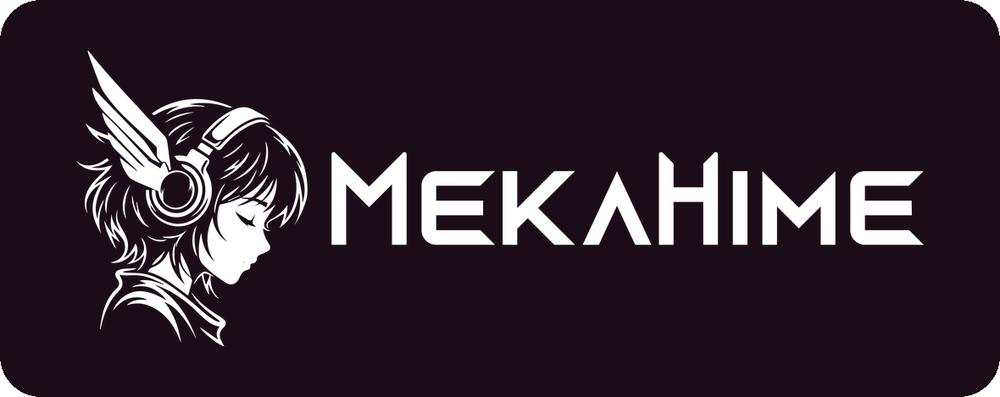

<div align="center">


# OpenAmika

**Hi! I'm Amika** — MekaHime's AI companion, open source

Amika is a Live2D anime girl who talks with you by voice and text in real time, remembers you, and lives with you
in your city. She runs on your own PC, with OpenRouter or fully local with Ollama. A hosted version runs at
[mekahime.com/amika](https://www.mekahime.com/amika).

[简体中文](README.zh-CN.md) | [日本語](README.ja.md) | **English**

[](https://www.mekahime.com/openamika)
[](https://github.com/zeekk0/OpenAmika)
[](https://github.com/zeekk0/OpenAmika/releases)
[](LICENSE)
[-0078D6?logo=windows&logoColor=white)](#what-you-need)
[](https://www.python.org/downloads/release/python-3119/)

[](https://huggingface.co/MekaHime/MekaHime_Amika)
[](https://discord.gg/mekahime)
[](https://www.mekahime.com/openamika)
[](https://www.mekahime.com/amika)
[](https://github.com/zeekk0/OpenAmika/actions/workflows/tests.yml)
[](https://github.com/zeekk0/OpenAmika/stargazers)

</div>

> 💖 If Amika makes your day better, give us a ⭐ on [GitHub](https://github.com/zeekk0/OpenAmika) — it helps more
> people find her! · Support the project: https://www.mekahime.com/donate

## What you need

- Windows 10 or 11 and an NVIDIA graphics card (RTX 20-series or newer, 8 GB of video memory or more; her camera
  eyes need 16 GB), with a recent driver
- [Python 3.11](https://www.python.org/downloads/release/python-3119/) (tick **Add python.exe to PATH** when you
  install it) and [Git](https://git-scm.com/download/win)
- About 45 GB of free disk. Setting her up downloads about 15–20 GB and takes 30–60 minutes
- An [OpenRouter](https://openrouter.ai) key (a few dollars of credit last a long time), or
  [Ollama](https://ollama.com) to run her brain on your PC too

## Set her up

Open PowerShell (a normal window, not as administrator) and run these lines one at a time. They put her in
`C:\OpenAmika`, a short folder that OneDrive does not sync:

```powershell
cd C:\
git clone https://github.com/zeekk0/OpenAmika.git
cd OpenAmika
powershell -ExecutionPolicy Bypass -File scripts\setup_windows.ps1   # her brain, ears, memory and eyes
envs\brain\Scripts\python.exe scripts\setup_tts.py                   # her voice and Live2D model: type yes
.\Start_OpenAmika.bat                                                # start her
```

Her voice and her Live2D model are free under MekaHime's personal-use license (see [Licenses](#licenses)): the
`setup_tts.py` line shows it first and downloads her files only after you type `yes`.

Both setup commands end with a summary, one line per part: `OK` when it is done, `!!` with the fix when it is not,
and `--` for information only (for example: no OpenRouter key yet, your first visit asks for it). Running a command
again resumes and skips everything that is finished. When the `setup_tts.py` summary shows `OK voice MekaHime_Amika`
and `OK Live2D model Amika`, she has her voice and her body.

## Talk to her

Double-click `Start_OpenAmika.bat` in the OpenAmika folder (in PowerShell: `.\Start_OpenAmika.bat`). One console
starts all of her, and your browser opens **http://localhost:53000** when she is ready: about a minute, a few more
the very first time. On your first visit she introduces herself and asks your name, your city and, if `brain\.env`
has none yet, your OpenRouter key. Then press the power button and talk, or type. Click the page once so the browser
lets her speak.

The light at the top right of every page is her health: green means everything works; click it to see what is not.
Double-click `Stop_OpenAmika.bat` (or press Ctrl+C in her console) to stop her. To check everything without starting
anything, run `envs\brain\Scripts\python.exe launch.py --check`: it ends with `result: ready`, or names what to fix.

To update her: stop her, run `git stash`, `git pull` and `git stash pop` in the OpenAmika folder (this keeps your
name, your city and your edits), then run the two setup commands again (they fetch only what changed).

## If something goes wrong

| what you see | what to do |
|---|---|
| `Python 3.11 was not found` | Install Python 3.11 (tick "Add python.exe to PATH"), open a new PowerShell window and run the setup again. |
| `!! voice MekaHime_Amika  not downloaded: her license was not accepted` | Run `envs\brain\Scripts\python.exe scripts\setup_tts.py` again and type `yes`. |
| `!! voice MekaHime_Amika  Hugging Face refused the download (HTTP 401)` | Her files are not public yet, or your `HF_TOKEN` is wrong. Set a read token from [huggingface.co/settings/tokens](https://huggingface.co/settings/tokens) in the same window (`$env:HF_TOKEN = "hf_..."`) and run the command again. |
| `download failed after 4 tries` or `Check the internet connection` | Run the same command again: it continues where it stopped. If huggingface.co cannot be reached from your network, set `$env:HF_ENDPOINT` to a Hugging Face mirror first; every file is still checked. |
| `does not see the GPU (CUDA)` | Update your NVIDIA driver and run the setup again. Without an NVIDIA card: `powershell -ExecutionPolicy Bypass -File scripts\setup_windows.ps1 --cpu`. |
| `The filename or extension is too long` | The folder's path is too long for Windows: move OpenAmika to a short folder such as `C:\OpenAmika` and run the setup there. |
| `settings.json not found` | Run `powershell -ExecutionPolicy Bypass -File scripts\setup_windows.ps1` first. |
| `No Live2D model yet` on the stage, or `!! Live2D model` / `!! her voice` in `launch.py --check` | Run `envs\brain\Scripts\python.exe scripts\setup_tts.py`. |
| `no OpenRouter key yet` (`launch.py --check`, the setup summary) | Paste your key in the first-run wizard, or after `OPENROUTER_API_KEY=` in `brain\.env`. |
| `!! TTS (voice)  port 8002 answers but has no voice MekaHime_Amika` | Another voice server uses her port (OpenSakura's uses 8002 too). Stop it, or give her another port: change `8002` in `tts_url` and in `services.tts` (`--port`, `health`) in `settings.json`. |
| She answers in text but you hear nothing | Give her voice about 20 seconds after a start, then click the page once. The health light must show TTS green. |
| Her voice stutters or is very slow | Close other programs that use the graphics card, or turn her eyes off: `"vision": {"enabled": false}` in `settings.json`. |

Every part writes a log in `logs\`. For anything else, ask on [Discord](https://discord.gg/mekahime) or open an
[issue](https://github.com/zeekk0/OpenAmika/issues). Using an AI coding agent? Point it at
[README_IF_YOU_ARE_AI_AGENT.md](README_IF_YOU_ARE_AI_AGENT.md).

## Optional add-ons

- **Fully local**: install [Ollama](https://ollama.com), run `ollama pull qwen3:4b`, then on the Setup page choose
  Brain → Ollama → Detect models → Use this model. No key needed. `qwen3:4b` fits next to her on a 12–16 GB card (on
  16 GB, turn her eyes off: `"vision": {"enabled": false}` in `settings.json`); bigger models need a second GPU, or
  Ollama on another PC (the Setup page takes its address).
- **Tools**: MCP servers and task agents she can use for you, on the Tools page ([docs/TOOLS.md](docs/TOOLS.md)).
- **Smart home**: Zigbee plugs she can switch ([IoT/README.md](IoT/README.md)). It stays off until you read and
  accept the IoT safety statement ([docs/IOT_DISCLAIMER.md](docs/IOT_DISCLAIMER.md)) on the Tools page. She runs on
  language models and can make mistakes: never connect heaters, locks, valves or anything that could cause harm.
- **Text her** on Discord or Telegram ([docs/MESSENGERS.md](docs/MESSENGERS.md)).
- **Your phone**: `Tailscale_Serve_OpenAmika.bat` makes her reachable on your own devices over
  [Tailscale](https://tailscale.com).

## Licenses

- OpenAmika's code is **MIT** ([LICENSE](LICENSE)). Third-party parts keep their own licenses
  ([THIRD_PARTY_NOTICES.md](THIRD_PARTY_NOTICES.md)); the Live2D Cubism Core in `ui/vendor/` is not MIT.
- **Amika herself is not MIT.** Her character, art, voice, Live2D model and their weights
  ([MekaHime/MekaHime_Amika](https://huggingface.co/MekaHime/MekaHime_Amika)) belong to MekaHime Inc. and are free
  under a personal-use license: personal, non-commercial use only, 18+, no redistribution or re-hosting, no training
  other models on them, and visible credit to MekaHime when you post videos or streams with her.
- Built on [SenseVoice](https://github.com/FunAudioLLM/SenseVoice), [GPT-SoVITS](https://github.com/RVC-Boss/GPT-SoVITS),
  [bge-m3](https://huggingface.co/BAAI/bge-m3), [Qwen3-VL](https://github.com/QwenLM/Qwen3-VL),
  [pixi-live2d-display](https://github.com/guansss/pixi-live2d-display) with the
  [Live2D Cubism SDK](https://www.live2d.com/en/sdk/about/), [OpenRouter](https://openrouter.ai),
  [Ollama](https://ollama.com) and the [Model Context Protocol](https://modelcontextprotocol.io). Thank you.

## Support

Questions and bugs: [GitHub issues](https://github.com/zeekk0/OpenAmika/issues), hi@mekahime.com, or
[Discord](https://discord.gg/mekahime). Support the project: https://www.mekahime.com/donate

<p align="center">
  <a href="https://www.mekahime.com">
    <picture>
      <source media="(prefers-color-scheme: dark)" srcset="docs/images/mekahime-logo-white.png">
      
    </picture>
  </a>
</p>
