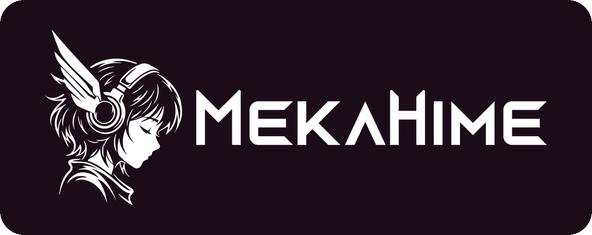

<!-- Translated from README.md; keep in sync when README.md changes. -->
<div align="center">


# OpenAmika

**你好！我是 Amika**——MekaHime 的 AI 伴侣，现已开源

Amika 是一个 Live2D 二次元少女：她能用语音和文字与你实时聊天，会记住你，还和你一起住在你所在的城市。她运行在你自己的电脑上，可以接入 OpenRouter，也可以借助 Ollama 完全本地运行；她拥有 Live2D 形象、能演绎 69 种情绪的实时语音，以及基于证据的长期记忆。你也可以在 [mekahime.com/amika](https://www.mekahime.com/amika) 体验在线托管版。

**简体中文** | [日本語](README.ja.md) | [English](README.md)

[](https://www.mekahime.com/openamika)
[](https://github.com/zeekk0/OpenAmika)
[](https://github.com/zeekk0/OpenAmika/releases)
[](LICENSE)
[-0078D6?logo=windows&logoColor=white)](#环境要求)
[](https://www.python.org/downloads/release/python-3119/)

[](https://huggingface.co/MekaHime/MekaHime_Amika)
[](https://discord.gg/mekahime)
[](https://www.mekahime.com/openamika)
[](https://www.mekahime.com/amika)
[](https://github.com/zeekk0/OpenAmika/actions/workflows/tests.yml)
[](https://github.com/zeekk0/OpenAmika/stargazers)

</div>

> 💖 如果 Amika 让你的一天变得更美好，就在 [GitHub](https://github.com/zeekk0/OpenAmika) 上给我们点个 ⭐ 吧——这能帮更多人找到她！· 支持本项目：https://www.mekahime.com/donate

> ⚠️ OpenAmika 的代码采用 MIT 许可证。Amika 的声音模型、Live2D 模型和参考音频版权归 MekaHime Inc. 所有，以个人使用许可证授权（详见 [Hugging Face 模型卡](https://huggingface.co/MekaHime/MekaHime_Amika)及其中的 LICENSE）：仅限个人、非商业用途，须年满 18 岁，不得再分发或重新托管，不得用于训练其他模型；发布有她出镜的视频或直播时，须清晰可见地注明 MekaHime。

报告 bug 可以前往 https://github.com/zeekk0/OpenAmika/issues 提交，或发邮件至 hi@mekahime.com，也可以在 Discord 上反馈：https://discord.gg/mekahime

项目主页：https://www.mekahime.com/openamika · 源代码：https://github.com/zeekk0/OpenAmika · 支持本项目：https://www.mekahime.com/donate

OpenAmika 是 Amika 的完整运行框架，全部开源：三层结构的大脑、基于证据的长期记忆、支持插话打断（barge-in）的实时语音、她的语音服务器、让她的表情与声音保持同步的 Live2D 舞台，以及可选的工具、智能家居、摄像头和 Discord/Telegram 渠道。Amika Online（在线托管应用）在 MekaHime 的服务器上运行的也是同一个大脑。

```
 you ──mic──▶ STT (SenseVoiceSmall, local) ──▶ brain: surface ─▶ deep ─▶ reflection ──▶ her voice server ──▶ 🔊
               Silero VAD · barge-in            │ OpenRouter or Ollama                       │ one emotion tag per sentence
                                                │ evidence memory (BM25 + local bge-m3)      ▼
                                                └─ optional: MCP tools · smart home        Live2D avatar (face + motion
                                                                                           start with the sentence)
```

## 项目里有什么

| 文件夹 | 内容 |
|---|---|
| `brain/` | 大脑（Flask-SocketIO）。三层提示词：**surface**（表层：即时的四行反射式回应）、**deep**（深层：她真正的回复，`[register_emotion]"speech"` 加上“我心想”内心独白）、**reflection**（反思：在后台做规划的教练，有时会让她主动开口）。证据记忆（`f_memory.py`，BM25 + 向量嵌入）、带预留与结算的逐次调用费用计量、MCP 工具阶段（`f_tools.py`）、Ollama 传输层（`f_ollama.py`），以及她的人设（`scenes.json`、`例子.txt`、`表层.txt`、`思考.txt`；出厂副本在 `brain/defaults/`） |
| `speech/` | 网关（FastAPI）：本地 SenseVoiceSmall 语音识别（STT，配合 Silero VAD 和插话打断）、流式分句、TTS 客户端和语音适配器、所有网页以及浏览器 WebSocket |
| `vendor/tts-engine/` | 她的语音服务器（`main.py`，MekaHime 定制构建的 GPT-SoVITS）；`scripts/setup_tts.py` 会在它旁边装好上游 GPT-SoVITS 及其模型、Amika 的声音和她的 Live2D 模型（见 [`vendor/tts-engine/README.md`](vendor/tts-engine/README.md)） |
| `ui/` | 四个页面：**Setup**（设置：健康状态、模型、声音、形象、性格）、**Tools**（工具：MCP 服务器、策略、审批）、**Use**（使用：电源、麦克风、Live2D 舞台、费用与延迟遥测）、**About**（关于：MekaHime、支持本项目、许可证）；交互式架构图位于 `/flow` |
| `avatar/` | 存放 Live2D 模型的地方（`avatar/models/<Name>/`；`setup_tts.py` 会把 Amika 的模型放在这里），另有 `retarget_motions.py` |
| `vision/` | 可选的摄像头：由一个本地小型视觉语言模型（VLM，默认 Qwen3-VL-2B）描述她看到的画面 |
| `messengers/` | 可选的 "Text her"（给她发消息）：Discord 和/或 Telegram 机器人，仅限文字 |
| `servers/` | 可选的 MCP 服务器：`openamika-iot`（通过 mosquitto + zigbee2mqtt 接入 Zigbee 智能家居）和 `openamika-agents`（Hermes Agent、nanoMuse） |
| `IoT/` | 智能家居的 Windows 安装脚本（CP210x 驱动、mosquitto、一个 zigbee2mqtt 串口补丁） |
| `config/` | 非机密设置：LLM 角色与预设、模型目录与价格、词语替换表，以及工具和消息机器人的配置示例 |
| `scripts/` | `download_sensevoice.py` 下载语音识别模型；`setup_tts.py` 安装她的声音和她的 Live2D 模型 |
| `launch.py` | 整套服务一个控制台搞定：启动前预检指示灯，按顺序启动所有服务，按 Ctrl+C 全部停止 |
| `docs/` | `ARCHITECTURE.md`、`PERSONALITY.md`、`TTS.md`、`AVATAR.md`、`TOOLS.md`、`MESSENGERS.md` |

## 两种运行方式

| | 大脑 | 耳朵、声音、记忆、形象 | 运行要求 | 费用 |
|---|---|---|---|---|
| **使用 OpenRouter**（默认） | OpenRouter：deep 层用 GLM-5，surface 和 reflection 层用 DeepSeek V4.1 Flash（可在 Setup 中更改） | 在你的电脑上 | Windows 10/11、约 6.5 GB 空闲显存的 NVIDIA GPU、16 GB 内存、约 25 GB 磁盘空间 | 每轮对话不到一美分；每次调用都会计量，Use 页面实时显示累计费用 |
| **完全本地**（Ollama） | Ollama，任意你拉取的模型（例如 `qwen3:8b`） | 在你的电脑上 | 同上，另加模型所需的显存（8B 模型还需约 6 GB） | 只有电费 |

除了 OpenRouter 模式下的 LLM 调用之外，任何关于你的数据都不会离开这台电脑：语音识别、她的声音、向量嵌入、记忆、对话记录和日志都留在本地。在完全本地模式下，则什么都不会离开。

### 哪些部分需要 GPU

| 组件 | 运行于 | 显存（约） | 没有 NVIDIA GPU 时 |
|---|---|---|---|
| 语音识别（SenseVoiceSmall） | CUDA | 约 1–2 GB | 在 settings.json 中设置 `"speech_device": "cpu"`：可以运行，只是更慢 |
| 记忆向量嵌入（BAAI/bge-m3） | CUDA | 约 1.5 GB | 将嵌入服务（embedder）设为 `"device": "cpu", "dtype": "fp32"`：可以运行，只是更慢 |
| 她的声音（OpenAmika 语音服务器，GPT-SoVITS） | CUDA | 约 2.2–2.5 GB | `python scripts\setup_tts.py --cpu`：可以运行，只是更慢；没有语音服务器时，她会用文字回答 |
| 视觉（可选，Qwen3-VL-2B） | CUDA | 约 4.3 GB | 保持 `vision.enabled` 为 false |
| LLM 角色 | OpenRouter，或在你的 GPU 上运行的 Ollama | 0，或模型本身的大小 | 使用 OpenRouter |
| Live2D 形象 | 你的浏览器（WebGL） | – | 任意现代桌面浏览器 |

在 16 GB 的 RTX 5080 上实测：语音识别、向量嵌入、视觉和语音服务器加在一起会占用显卡的大部分显存，因此 7–8B 的 Ollama 模型无法和它们同时放下。你可以关闭视觉、换一个更小的模型，或者在另一台电脑上运行 Ollama（在 Setup → Brain 中填入它的 URL）。

## 环境要求

- **Windows 10/11**（代码是纯 Python，稍作路径调整后应该能移植到 Linux/macOS，但尚未测试）。
- **Python 3.11** 环境。下面的指南使用 [Miniconda](https://docs.anaconda.com/miniconda/)，并把所有环境都放在 OpenAmika 文件夹内（`envs\…`），这样 settings.json 里就不需要写绝对路径。她的语音服务器有自己独立的 venv（`vendor\tts-engine\.venv`），由 `scripts\setup_tts.py` 创建。
- 一块装有较新驱动的 **NVIDIA GPU**（见上表；RTX 50 系列显卡需要指南中安装的 CUDA 12.8 版本），以及 [Git](https://git-scm.com/download/win)。
- 一个 [OpenRouter](https://openrouter.ai) 密钥，**或者**装好模型的 [Ollama](https://ollama.com)。

## 安装（Windows）

请在可以使用 conda 的终端中操作（Anaconda Prompt，或已执行过 `conda init` 的 PowerShell）。下载总量约 12–14 GB，其中大部分是 PyTorch。

```powershell
git clone https://github.com/zeekk0/OpenAmika.git
cd OpenAmika

# 1. 在项目文件夹内创建三个环境
conda create -y -p envs\brain  python=3.11
conda create -y -p envs\speech python=3.11
conda create -y -p envs\embed  python=3.11

# 2. 大脑（不需要 GPU）
envs\brain\python.exe -m pip install -r brain\requirements.txt

# 3. 语音：先装 CUDA 版 PyTorch（cu128 = CUDA 12.8 的 wheel，适用于 RTX 20/30/40/50 系列；
#    更老的显卡请到 https://pytorch.org/get-started/locally/ 选择对应的命令），再装其余依赖
envs\speech\python.exe -m pip install torch torchaudio --index-url https://download.pytorch.org/whl/cu128
envs\speech\python.exe -m pip install -r speech\requirements.txt

# 4. 记忆嵌入服务（单独一个环境，让它的 Hugging Face 相关版本与语音环境互不干扰）
envs\embed\python.exe -m pip install torch --index-url https://download.pytorch.org/whl/cu128
envs\embed\python.exe -m pip install -r brain\requirements-embedder.txt

# 5. 语音识别模型（约 940 MB，带校验和；遇到网络错误时重新运行即可）
envs\speech\python.exe scripts\download_sensevoice.py

# 6. 她的声音和她的 Live2D 模型（需下载约 5.5 GB；输入 yes 接受她的许可证）
envs\brain\python.exe scripts\setup_tts.py

# 7. 你的设置和密钥
copy settings.example.json settings.json
copy .env.example brain\.env
notepad brain\.env        # 把你的密钥填在 OPENROUTER_API_KEY= 后面（完全本地运行可跳过）
```

可选组件：

```powershell
# 视觉（她的摄像头眼睛）：使用独立环境，装好后在 settings.json 中设置 "vision": {"enabled": true}
conda create -y -p envs\vision python=3.11
envs\vision\python.exe -m pip install torch --index-url https://download.pytorch.org/whl/cu128
envs\vision\python.exe -m pip install -r vision\requirements.txt

# "Text her" 功能所需的 Discord 依赖（Telegram 无需额外安装）
envs\speech\python.exe -m pip install -r messengers\requirements.txt
```

## 启动她

```powershell
envs\brain\python.exe launch.py --check   # 全面检查（导入、文件、端口、密钥），不启动任何服务
Start_OpenAmika.bat                       # 单个控制台：先预检，再启动她的语音服务器，然后依次启动 embedder → brain → vision → speech
```

语音网关就绪后，浏览器会自动打开 **http://localhost:53000** 页面。首次启动会把 bge-m3 嵌入模型（约 2.3 GB）下载到你的 Hugging Face 缓存中，所以请耐心等几分钟；之后每次启动大约需要一分钟。`Stop_OpenAmika.bat`（或在启动器控制台中按 Ctrl+C）会停止启动器启动的所有服务。

在 **Use** 页面，一个只出现一次的向导会把她介绍给你：她会问你的名字（还可以填写读音提示，让她念对你的名字）、你所在的城市和她的时钟（即时区，会从你的浏览器自动检测）；如果 `brain/.env` 里还没有 OpenRouter 密钥，向导会让你填入；最后运行健康检查。之后按下电源键，就可以开口和她聊天，或者打字。

每个页面右上角的指示灯表示系统健康状态：绿色为 *System Ready*（系统就绪），黄色为 *Warnings*（警告），红色为 *System Failures*（系统故障）；点击它即可查看哪里出了问题。没有语音服务器时，它会一直亮黄灯，她会用文字回答。

### 使用 OpenRouter

在 [openrouter.ai](https://openrouter.ai) 注册账号，充值几美元，在 [openrouter.ai/keys](https://openrouter.ai/keys) 创建一个密钥，然后填入 `brain/.env`（或者直接在向导里粘贴）。默认的角色配置是一套经过评测的预设；Setup → Brain 会列出其他可选模型及其价格，Use 页面则会实时显示本次会话的花费。

### 使用 Ollama 完全本地运行

1. 从 [ollama.com/download](https://ollama.com/download) 安装 Ollama，然后拉取一个模型：`ollama pull qwen3:8b`（显卡较小的话用 `qwen3:4b`）。
2. 启动 OpenAmika，打开 **Setup → Brain**，切换到 **Ollama**，点击 **Detect models**，选一个模型后点击 **Use**：四个角色（surface、deep、reflection、memory writer）就都改由它来运行了。首次运行时，向导里也提供同样的切换选项。
3. 不需要任何密钥；当所有角色都在本地运行时，`launch.py --check` 会显示 "API keys: none needed"。调用依然会记录在同一个账本里，费用为零。小模型对她性格的把握不如 OpenRouter 预设那么稳定；在 Professional 模式下可以混搭使用（部分角色用本地模型，其余用 OpenRouter）。

### 她的声音

她的声音模型免费提供，无需注册账号。它是 MekaHime 的资产，采用[个人使用许可证](https://huggingface.co/MekaHime/MekaHime_Amika/blob/main/LICENSE)授权：仅限个人和业余爱好用途，须年满 18 岁，不得用于训练其他模型，不得重新托管；发布有她出镜的视频或直播时，须清晰可见地注明 MekaHime。`scripts\setup_tts.py` 会先显示这些条款并请你输入 `yes`，随后自动完成安装（加上 `--accept-voice-license` 可跳过这一询问）：OpenAmika 语音服务器（`vendor/tts-engine`，MekaHime 定制构建的 GPT-SoVITS）、上游 GPT-SoVITS 及其模型，以及来自 [MekaHime/MekaHime_Amika](https://huggingface.co/MekaHime/MekaHime_Amika) 的 Amika 声音。脚本最后会输出一份汇总，其中最关键的是这一行：

```
  OK voice MekaHime_Amika  ...\Speakers\MekaHime_Amika (downloaded from MekaHime/MekaHime_Amika@...; 69/69 emotion tags with a clip; all 67 tags OpenAmika's voice adapter can send have one)
```

如果这一行显示的是 `!!`，请对照下表处理，然后重新运行同一条命令：已完成的步骤会经过校验后跳过，所以重跑只需几秒钟。`settings.example.json` 已经配置好由启动器启动语音服务器（`services.tts`，端口 8002，音色 `MekaHime_Amika`）；如果你的 `settings.json` 与之不同，汇总中的 `launcher` 一行会告诉你。

| 你看到的提示 | 解决方法 |
|---|---|
| `!! voice MekaHime_Amika  not downloaded: her voice license was not accepted` | 重新运行 `envs\brain\python.exe scripts\setup_tts.py`，并在询问时输入 `yes`。 |
| `!! voice MekaHime_Amika  download failed (network / HTTP error)` | 检查网络连接（必须能访问 Hugging Face），然后重新运行；已完成的步骤会被跳过。 |
| `the voice engine needs Python 3.11 or 3.12` | 用 Python 3.11 运行该脚本（`envs\brain\python.exe`），或者传入 `--python <path to python.exe>`。 |
| `-- launcher  ...` | 把 `settings.example.json` 中的 `"tts_character"` 和 `"services"` → `"tts"` 条目复制到你的 `settings.json` 里。 |
| 她用文字回复了，但你什么也听不到 | `launch.py --check` 和健康指示灯都必须显示 **TTS** 为绿色；启动后给她约 20 秒准备时间；在页面上点击一下，让浏览器允许播放声音。 |
| 她的声音被截断，或者非常慢 | 关闭其他占用 GPU 较多的应用，或者关闭视觉功能：语音服务器需要约 2.5 GB 空闲显存。 |

更多细节（命令行参数、各组件安装到哪里、服务器如何使用上游、实测数据）见 [`vendor/tts-engine/README.md`](vendor/tts-engine/README.md)；请求约定和语音适配器见 [`docs/TTS.md`](docs/TTS.md)。

### 她的样子

同一个脚本还会从同一个仓库、按同样的许可证，把**她的 Live2D 模型**下载到 `avatar/models/Amika/`，这样首次启动时就能在 Use 页面看到她（加上 `--skip-avatar` 则不下载；此时舞台上会显示 "No Live2D model yet"，其他功能一切正常）。其他任何 Cubism 模型也都能用：把模型文件夹放进 `avatar/models/<Name>/`，然后刷新页面即可；免费示例模型和情绪库请见 [`avatar/models/README.md`](avatar/models/README.md)。

### 用手机访问（Tailscale）

应用特意只绑定在 127.0.0.1 上。想从你自己的其他设备访问，请使用 [Tailscale Serve](https://tailscale.com/kb/1312/serve)，而不是对外开放端口：

```text
Tailscale_Serve_OpenAmika.bat          →  https://<your-machine>.<tailnet>.ts.net:8447/
Tailscale_Serve_OpenAmika.bat off      →  remove the mapping
```

tailscaled 会用真实有效的证书终止 HTTPS（需要在 tailnet 上启用 MagicDNS 和 HTTPS），所以在手机上也能使用麦克风。同一时间只能打开一个对话标签页。

## 她是谁

Amika（桜井美香，Sakurai Mika）在京都长大，是神社世家的继承人。十八岁那年，她厌倦了每一步都被安排好的生活；那时你们已经在网上成了很要好的朋友，于是她飞到**你的城市**，和**你**做起了室友。她的一天按照她自己的时钟展开：每个时段都有五种可能（早晨散步、逛超市、下午的活动、去健身房、晚上的神社功课、深夜刷手机），每天只抽选一次，这样聊到一半，她下午的安排也不会突然改变。

她会用你告诉她的名字称呼你（`{user_name}` 和 `{city}` 由向导填入），人设是按照一位比她稍大一点的年轻男性来写的（中文提示词里用的是“他”）。你吃东西的时候，无论用哪种语言聊天，她都会用同一句固定的英文台词 "You Holy Big Fat Ass" 来调侃你：这是她的粉丝都懂的老梗。所有内容都可以在 Setup 页面（Personality）中编辑；[`docs/PERSONALITY.md`](docs/PERSONALITY.md) 介绍了三层结构、哪些地方可以放心修改，以及 *Reset everything* 如何从 `brain/defaults/` 恢复出厂人设。

提示词特意用中文编写（她的内心独白始终是中文）；她会用你说的语言回答（英语、日语或中文），对她说一句“用日语说”，就能临时切换一轮。

## 配置

| 文件 | 内容 | 是否纳入 git |
|---|---|---|
| `settings.json` | 解释器、端口、STT 设备、TTS 地址与音色、embedder 和 vision 配置块、可选服务（她的语音服务器） | 否（复制自 `settings.example.json`） |
| `brain/.env` | API 密钥（`OPENROUTER_API_KEY`，以及可选的其他提供商） | 否（复制自 `.env.example`） |
| `config/build_f.json` | 你的名字、你的城市、她的时钟、记忆预算、reflection 开关 | 是（向导和 Setup 会把你的名字和城市写到这里） |
| `config/llm_roles.json` | 四个 LLM 角色、预设以及你的选择 | 是 |
| `config/word_replace.json` | 语音识别纠错和 TTS 读音（包括你名字的读音） | 是 |
| `config/tools.json`、`config/messengers.json` | MCP 服务器和机器人令牌（来自 `.example.json` 示例文件，或通过 Tools / Setup 页面设置） | 否 |
| `brain/scenes.json` + 三个模板 | 她的人设 | 是 |

运行时数据都保存在本地，并已被 git 忽略：`memory_f/`（她的记忆和费用账本）、`brain/memories/`、`logs/`，以及 `setup_tts.py` 下载的所有内容（`vendor/tts-engine/` 中代码以外的部分、`avatar/models/Amika/`）。如果你要公开发布自己的 fork，请先检查 `config/build_f.json` 和 `config/word_replace.json`：完成首次设置后，这两个文件里会有你的名字和城市。

## 端口

| 服务 | 端口 | 配置位置 |
|---|---|---|
| 网页 + 语音网关 | 53000 | `settings.json` `chat_port` |
| 大脑（brain） | 5202 | `brain_port` |
| 嵌入服务（embedder） | 8011 | `embedder.port` |
| 视觉（可选） | 8014 | `vision.port` |
| Discord/Telegram 服务 | 5215 | 固定 |
| 她的语音服务器 | 8002 | `tts_url` + `services.tts` |
| Ollama | 11434 | Setup → Brain |
| MQTT / zigbee2mqtt（可选） | 1883 / 8080 | `services` |

所有服务都只绑定在 127.0.0.1 上。

## 可选功能

- **工具**（Tools 页面，`docs/TOOLS.md`）：支持任意 MCP 服务器（stdio 或 HTTP），每个工具都可以单独设置 `auto` / `confirm` / `deny` 策略。个人任务智能体（Hermes Agent、nanoMuse）通过 `servers/openamika-agents` 接入。
- **智能家居**（`IoT/README.md`）：通过 mosquitto + zigbee2mqtt 和项目自带的 `openamika-iot` MCP 服务器控制 Zigbee 智能插座；也可以使用 Home Assistant 自己的 MCP 服务器。
- **Text her**（给她发消息，`docs/MESSENGERS.md`）：一个 Discord 和/或 Telegram 机器人，只回复你允许的用户 ID。
- **摄像头**（`vision/`）：摄像头开启时，她会描述自己看到的画面；画面帧永远不会离开这台电脑。

## 测试

```powershell
envs\brain\python.exe -m pip install -r requirements-dev.txt
envs\brain\python.exe -m pytest tests -k "not live"
```

大约 350 个离线测试，覆盖输出约定、两个流式解析器（brain 与 speech 两侧保持一致）、提示词拼装与缓存布局、记忆渲染、用量账本、控制代理、工具调度（tool clerk）以及启动器。需要 MekaHime 归档语料的回放测试会自动跳过。每次 push 时，GitHub Actions 都会运行同一套测试（`.github/workflows/tests.yml`）。

## 未包含的内容

- **Amika 的声音和 Live2D 模型不在 git 仓库里**。它们是 MekaHime 的资产；在你接受其个人使用许可证后，`scripts/setup_tts.py` 会从 [MekaHime/MekaHime_Amika](https://huggingface.co/MekaHime/MekaHime_Amika) 下载它们。
- **模型权重**。SenseVoiceSmall 由 `scripts/download_sensevoice.py` 下载，GPT-SoVITS 及其预训练模型由 `scripts/setup_tts.py` 下载；bge-m3 和视觉模型会在首次使用时下载到 Hugging Face 缓存中。
- **第三方组件**：如有需要请自行安装，包括 Ollama、zigbee2mqtt、mosquitto、Hermes Agent、nanoMuse。
- **任何人的数据**。仓库不附带任何记忆、对话记录、日志或密钥；附带的身份信息只是中性的默认值，首次运行时会被向导替换。

代码注释中引用的 `CONTRACT §…`、`TELEMETRY_SPEC §…` 或 `BUILD_SPEC`，指的是 MekaHime 前代版本的内部设计文档，它们不包含在本仓库中。

## 备注

- Use 页面会在加载两分钟后弹出一个小小的 "Support MekaHime" 窗口，之后每 30 分钟弹出一次；窗口里有 "never show this again"（不再显示）选项（保存在你的浏览器中），在地址末尾加上 `?kiosk=1` 也可以关闭它，方便录制干净的画面。**About** 页面（在菜单里）也有同样的按钮，还有团队介绍和许可证信息。
- 她的语音服务器输出 WAV 格式（这是语音网关所要求的），所有浏览器都能播放。

## 致谢

由 MekaHime 打造，站在这些项目的肩膀上：[SenseVoice / FunASR](https://github.com/FunAudioLLM/SenseVoice)（语音识别）、[Silero VAD](https://github.com/snakers4/silero-vad)、[GPT-SoVITS](https://github.com/RVC-Boss/GPT-SoVITS)（她的声音）、[BAAI bge-m3](https://huggingface.co/BAAI/bge-m3)（记忆向量嵌入）、[Qwen3-VL](https://github.com/QwenLM/Qwen3-VL)（视觉）、[PixiJS](https://pixijs.com) 和 [pixi-live2d-display](https://github.com/guansss/pixi-live2d-display) 配合 [Live2D Cubism SDK](https://www.live2d.com/en/sdk/about/)（形象）、[OpenRouter](https://openrouter.ai) 和 [Ollama](https://ollama.com)（她的大脑）、[Model Context Protocol](https://modelcontextprotocol.io)（工具）、[zigbee2mqtt](https://www.zigbee2mqtt.io) 和 [Eclipse Mosquitto](https://mosquitto.org)（智能家居）。

<p align="center">
  <a href="https://www.mekahime.com">
    <picture>
      <source media="(prefers-color-scheme: dark)" srcset="docs/images/mekahime-logo-white.png">
      
    </picture>
  </a>
</p>

## 许可证

- OpenAmika 的代码和文本：**MIT**，© MekaHime Inc.（`LICENSE`）。
- 她的语音服务器（`vendor/tts-engine/main.py`，MekaHime 定制构建的 GPT-SoVITS）：**MIT**（见其自带的 `LICENSE`）；上游 GPT-SoVITS（MIT）及其预训练模型由 `scripts/setup_tts.py` 下载，各自遵循其原有许可证（`vendor/tts-engine/THIRD_PARTY_NOTICES.md`）。
- 随附的第三方文件保留各自的许可证（`THIRD_PARTY_NOTICES.md`）：SenseVoice 模型代码（MIT）、PixiJS 和 pixi-live2d-display（MIT），以及 **Live2D Cubism Core**（`ui/vendor/live2dcubismcore.min.js`，适用 Live2D Proprietary Software License Agreement，而非 MIT）。
- 下载的模型（SenseVoiceSmall、bge-m3、视觉模型、LLM）遵循各自的许可证。
- Amika 的声音模型及其参考音频，以及她的 Live2D 模型（[MekaHime/MekaHime_Amika](https://huggingface.co/MekaHime/MekaHime_Amika)），版权归 MekaHime Inc. 所有，采用 MekaHime Amika personal-use license（个人使用许可证）授权：仅限个人、非商业用途，须年满 18 岁，不得再分发，不得用于训练其他模型，发布含有她的内容时须清晰可见地署名。MIT License 不涵盖这些内容。
- Amika 这个角色（她的名字、设计和形象）版权归 MekaHime Inc. 所有；MIT License 不授予任何与之相关的权利。欢迎你把这份人设改造成属于你自己的伴侣。

有问题请联系：hi@mekahime.com · 支持我们的开源工作：https://www.mekahime.com/donate
